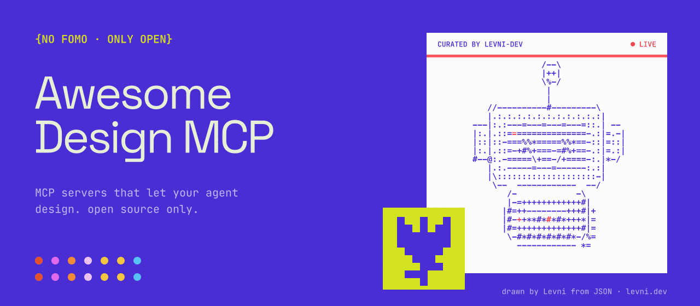

<a href="https://github.com/Levni-Dev/awesome-design-mcp"></a>

<div align="center">

[](https://awesome.re) [](CONTRIBUTING.md) [](LICENSE)

**Open-source MCP servers that let AI agents like Claude, Codex and Cursor do design work: editors, 3D, diagrams, icons, type, colour and assets.**

[Suggest a project](../../issues/new?template=suggest.yml) · [How we curate](CONTRIBUTING.md) · [More lists](#more-lists-from-levni-dev) · [levni.dev](https://levni.dev)

</div>

> Your agent can already write code. With the right MCP server it can also open a design file, draw a diagram, pick a palette or render a poster. No need to wait for the next big launch: these servers are open source and work today.
>
> **The rule: no FOMO, only open.** Open licence, free to start, alive and useful. No credit card, no paid API key, no waitlist.

## What is MCP?

[MCP](https://modelcontextprotocol.io/) (Model Context Protocol) is the open standard that lets an AI agent use tools. An MCP server is a small program that gives Claude, Codex, Cursor or any MCP client new abilities, here: design abilities.

**Add one to Claude Code in one line:**

```bash
claude mcp add levni -- npx -y @levni/levni mcp
```

Claude Desktop, Cursor and others take the same command in a JSON config. Every entry below links to its own setup.

## Legend

- 🎖️ official server from the tool maker
- 📇 TypeScript or JavaScript · 🐍 Python · #️⃣ C#
- `Licence` the open licence of the code

## Contents

- [Figma, Penpot and design suites](#figma-penpot-and-design-suites)
- [Editors, illustration and pixel art](#editors-illustration-and-pixel-art)
- [3D and CAD](#3d-and-cad)
- [Diagrams and whiteboards](#diagrams-and-whiteboards)
- [Icons, fonts, colour and brand assets](#icons-fonts-colour-and-brand-assets)
- [UI components and design systems](#ui-components-and-design-systems)
- [Visual review and screenshots](#visual-review-and-screenshots)
- [Slides, video and motion](#slides-video-and-motion)
- [Hosted, not open source](#hosted-not-open-source)
- [More lists from Levni-Dev](#more-lists-from-levni-dev)
- [Thanks](#thanks)
- [Made with Levni](#made-with-levni)

## Figma, Penpot and design suites

- [Framelink Figma MCP](https://github.com/GLips/Figma-Context-MCP) 📇 - Reads Figma file layout and styles through the REST API so a coding agent can build the UI from a frame. `MIT`
- [Cursor Talk to Figma](https://github.com/grab/cursor-talk-to-figma-mcp) 📇 - Two-way bridge through a Figma plugin: the agent reads and edits layers, text and styles in an open file. `MIT`
- [Figma Console MCP](https://github.com/southleft/figma-console-mcp) 📇 - Extract tokens and components from Figma, create or edit nodes and debug a design system from the agent. `MIT`
- [Figwright](https://github.com/awdr74100/figwright) 📇 - Free two-way Figma server: turns designs into framework-aware code and pushes UI back into Figma. `MIT`
- [Figma MCP Bridge](https://github.com/gethopp/figma-mcp-bridge) 📇 - Figma plugin plus MCP server that reads and writes the open file locally, avoiding REST API rate limits. `MIT`
- [Penpot MCP (official)](https://github.com/penpot/penpot/tree/develop/mcp) 🎖️ - Official server in the Penpot monorepo (mcp/ folder); queries, creates and edits shapes via the Plugin API. `MPL-2.0`
- [Affinity MCP Server](https://github.com/sekharmalla/affinity-mcp-server) 📇 - Drives Affinity Designer, Photo and Publisher on macOS so the agent can create and edit documents. `MIT`
- [Photoshop MCP](https://github.com/alisaitteke/photoshop-mcp) 📇 - 118 tools to control Adobe Photoshop: layers, selections, text, filters and export. `MIT`
- [Adobe MCP (InDesign, Illustrator, Photoshop)](https://github.com/zachshallbetter/adobe-mcp) - Local servers that script InDesign, Illustrator and Photoshop documents from the agent. `MIT`

## Editors, illustration and pixel art

- [Inkscape MCP (aravindev)](https://github.com/aravindev/inkscape_mcp) 🐍 - Lets the agent draw and edit SVG in Inkscape, live next to the GUI or headless. `MIT`
- [Inkscape MCP (sandraschi)](https://github.com/sandraschi/inkscape-mcp) 🐍 - Headless Inkscape via FastMCP: 60+ operations such as shapes, boolean ops, path effects and export. `MIT`
- [GIMP MCP](https://github.com/gimp-mcp/gimp-mcp) 🐍 - Controls a running GIMP: open images, work with layers, apply filters, run Python-Fu and export. `GPL-3.0`
- [Krita MCP (nanayax3)](https://github.com/nanayax3/krita-mcp) 🐍 - Lets the agent paint in Krita: brush strokes, layers and canvas actions. `MIT`
- [Krita MCP (SanSaSane)](https://github.com/SanSaSane/krita-mcp) 🐍 - Krita server covering layers, drawing, filters and export. `CC0-1.0`
- [ImageSorcery MCP](https://github.com/sunriseapps/imagesorcery-mcp) 🐍 - Local image operations for agents: crop, resize, rotate, draw text and shapes, detect objects, OCR. `MIT`
- [image2svg MCP](https://github.com/botmonster/image2svg-mcp) 🐍 - Converts PNG, JPG or WEBP files to SVG vector paths locally. `Apache-2.0`
- [Levni](https://github.com/Levni-Dev/levni) 📇 - Renders hand-inked illustrations, 3D covers and icons from JSON scenes; no generative model, runs locally. `MIT`
- [Aseprite AI Artist](https://github.com/with-pebbly/aseprite-ai-artist) 📇 - Agent paints pixel art and animation frames directly in an open Aseprite window via an extension. `MIT`

## 3D and CAD

- [Blender MCP](https://github.com/ahujasid/mcp-for-blender) 🐍 - Blender add-on plus server: create and edit objects, materials and scenes, fetch assets, run Python. `MIT`
- [FreeCAD MCP](https://github.com/neka-nat/freecad-mcp) 🐍 - Create and edit parametric FreeCAD documents, objects and views, and run Python in them. `MIT`
- [Kiln](https://github.com/instruktlabs/kiln) 📇 - Local engine that builds and revises procedural 3D assets from code; CLI, SDK and MCP. `MIT`
- [Three.js DevTools MCP](https://github.com/DmitriyGolub/threejs-devtools-mcp) 📇 - Inspect and edit a running Three.js scene: objects, materials and shaders. `MIT`
- [Unity MCP (Coplay)](https://github.com/CoplayDev/unity-mcp) #️⃣ - Bridge to the Unity Editor: manage scenes, assets, scripts and components from the agent. `MIT`
- [Godot MCP](https://github.com/Coding-Solo/godot-mcp) 📇 - Launch the Godot editor, run projects, read debug output and create or edit scenes. `MIT`

## Diagrams and whiteboards

- [draw.io MCP (official)](https://github.com/jgraph/drawio-mcp) 🎖️ 📇 - Official draw.io server: agent creates diagrams and opens them in the draw.io editor. `Apache-2.0`
- [draw.io MCP Server (lgazo)](https://github.com/lgazo/drawio-mcp-server) 📇 - Inspects and edits diagrams in a live draw.io session through a browser extension. `MIT`
- [mcp-mermaid](https://github.com/hustcc/mcp-mermaid) 📇 - Renders Mermaid code to PNG, SVG or share links so the agent can check its own diagram. `MIT`
- [Mermaid MCP Server (peng-shawn)](https://github.com/peng-shawn/mermaid-mcp-server) 📇 - Converts Mermaid diagrams to PNG images using a headless browser. `MIT`
- [PlantUML MCP (official)](https://github.com/plantuml/plantuml-mcp) 🎖️ 🐍 - Official PlantUML server that renders UML and other PlantUML diagrams to images. `MIT`
- [PlantUML MCP Server (Infobip)](https://github.com/infobip/plantuml-mcp-server) 📇 - Generates and encodes PlantUML diagrams, returning image URLs or files. `MIT`
- [AntV MCP Server Chart](https://github.com/antvis/mcp-server-chart) 📇 - 25+ chart types (bar, line, pie, maps, mind maps, flow) rendered as images from agent data. `MIT`
- [Excalidraw MCP (Scofieldfree)](https://github.com/Scofieldfree/excalidraw-mcp) 📇 - Create and edit Excalidraw sketches and diagrams from the agent. `MIT`
- [Excalidraw Icons MCP](https://github.com/iagogfe/excalidraw-icons-mcp) 📇 - Excalidraw server that searches and inserts real AWS, Azure and GCP vendor icons into diagrams. `MIT`

## Icons, fonts, colour and brand assets

- [Dashboard Icons](https://github.com/homarr-labs/dashboard-icons) 📇 - 3,400+ app and service icons with an MCP endpoint that matches a docker-compose file to icons. `Apache-2.0`
- [theSVG](https://github.com/glincker/thesvg) 📇 - 7,900+ brand logos and icons as SVG; the MCP server searches and returns them to the agent. `MIT`
- [Keyline Icons](https://github.com/keyline-icons/keyline-icons) 📇 - 2,169 MIT icons in four styles; the @keyline-icons/mcp package searches by name and returns SVG. `MIT`
- [Lucide Icons MCP](https://github.com/SeeYangZhi/lucide-icons-mcp) 📇 - Search Lucide icons and fetch their SVG or component code as resources and tools. `MIT`
- [Iconify MCP Server](https://github.com/imjac0b/iconify-mcp-server) 📇 - Searches Iconify's 200k+ icon sets and returns SVG or usage snippets. `GPL-3.0`
- [Pocket Design MCP](https://github.com/jasonmello/pocket-design-mcp) 📇 - Free toolbox: icons from 280 sets, fonts, images, tokens, easings and contrast checks. `Apache-2.0`
- [Punchcutter](https://github.com/byrishi/punchcutter) 🐍 - Builds fonts from a description or a handwriting sheet photo; MCP tools create and export the font. `MIT`

## UI components and design systems

- [shadcn/ui MCP (official)](https://github.com/shadcn-ui/ui) 🎖️ 📇 - Built-in server in the shadcn CLI: browse registries and add components to a project by name. `MIT`
- [21st.dev Magic MCP](https://github.com/21st-dev/magic-mcp) 📇 - Searches a library of React and Tailwind components and inserts them into your project from the editor. `ISC`
- [Dembrandt](https://github.com/dembrandt/dembrandt) 📇 - Extracts a site's colours, type and spacing into design tokens; also runs as an MCP server. `MIT`
- [HeroUI MCP](https://github.com/heroui-inc/heroui-mcp) 📇 - Serves HeroUI React v3 and Native component docs, props and examples to the agent. `MIT`
- [UI UX Pro MCP](https://github.com/redf0x1/ui-ux-pro-mcp) 📇 - Curated style, palette and font-pairing data that the agent queries when designing screens. `MIT`
- [MarmoUI](https://github.com/mahmoudilyan/marmoui) 📇 - Open-source React design system with an MCP server so the agent assembles screens from its components. `MIT`

## Visual review and screenshots

- [Playwright MCP](https://github.com/microsoft/playwright-mcp) 🎖️ 📇 - Drives a real browser: navigate, click, resize and take screenshots to check a UI. `Apache-2.0`
- [Chrome DevTools MCP](https://github.com/ChromeDevTools/chrome-devtools-mcp) 🎖️ 📇 - Inspect live pages in Chrome: screenshots, DOM, CSS, console and performance traces. `Apache-2.0`
- [ScreenshotMCP](https://github.com/upnorthmedia/ScreenshotMCP) 📇 - Captures full-page or viewport website screenshots at chosen sizes for the agent to review. `MIT`

## Slides, video and motion

- [Presenton](https://github.com/presenton/presenton) 📇 - Self-hosted presentation generator with a built-in MCP endpoint; exports PPTX and PDF. `Apache-2.0`
- [ppt-mcp](https://github.com/ykuwai/ppt-mcp) 🐍 - Real-time control of PowerPoint: slides, shapes, text, layouts and formatting. `MIT`
- [mcp-server-powerpoint](https://github.com/sbroenne/mcp-server-powerpoint) #️⃣ - Automates desktop Microsoft PowerPoint from an agent: slides, shapes, tables, export. `MIT`
- [DaVinci Resolve MCP](https://github.com/samuelgursky/davinci-resolve-mcp) 🐍 - Controls DaVinci Resolve Studio: media pool, timelines, edits, colour and render queue. `MIT`
- [After Effects MCP](https://github.com/Dakkshin/after-effects-mcp) 📇 - Remote control of Adobe After Effects: compositions, layers, keyframes and effects. `MIT`
- [OpenChatCut](https://github.com/0xsline/OpenChatCut) 📇 - Local video editor with a multitrack timeline that external MCP agents can edit and export. `AGPL-3.0`

## Hosted, not open source

Useful, official, but not open. Listed so you know they exist; prefer the open ones above.

- [Figma MCP (official, remote)](https://mcp.figma.com/mcp) - Figma's own hosted server: design context, variables and Code Connect for coding agents; no source published.
- [Canva MCP (official, remote)](https://mcp.canva.com/mcp) - Canva's hosted server for creating, searching and exporting Canva designs from an agent.
- [Mermaid Chart MCP](https://mcp.mermaidchart.com/mcp) - Hosted Mermaid Chart server for diagram validation and rendering (GitHub repo Mermaid-Chart/mermaid-mcp returned 404).
- [Icons8 MCP](https://mcp.icons8.com/mcp/) - Hosted search and fetch of Icons8 icons and Ouch illustrations.
- [LottieFiles Creator](https://creator.mcp.lottiefiles.com/mcp) - Hosted motion engine that builds Lottie layers and keyframes; only a plugin repo is public.

## More lists from Levni-Dev

- [Awesome Open Design](https://github.com/Levni-Dev/awesome-open-design) - the hub: tools, icons, illustrations, fonts, colour, creative code.
- [Awesome Design MCP](https://github.com/Levni-Dev/awesome-design-mcp) - MCP servers that let AI agents design. *(you are here)*
- [Awesome Lettering](https://github.com/Levni-Dev/awesome-lettering) - type design, open fonts, lettering and kinetic type.

## Thanks

This list stands on the shoulders of [sindresorhus/awesome](https://github.com/sindresorhus/awesome), the list of awesome lists that started the format. For MCP servers beyond design, go to [punkpeye/awesome-mcp-servers](https://github.com/punkpeye/awesome-mcp-servers), with [awesome-mcp-clients](https://github.com/punkpeye/awesome-mcp-clients) and [awesome-remote-mcp-servers](https://github.com/punkpeye/awesome-remote-mcp-servers) for clients and hosted servers. We keep the design corner; they keep the whole map.

## Made with Levni

The banner above was drawn by [Levni](https://levni.dev), an open-source design engine for AI agents, from a few lines of JSON. No image model, no API key. Try it: `claude mcp add levni -- npx -y @levni/levni mcp`


## Contributing

Found something open that belongs here, or made it yourself? [Suggest it](../../issues/new?template=suggest.yml) in one minute, or read [how we curate](CONTRIBUTING.md). Every accepted suggestion is credited.

---

<div align="center">
<sub>Curated by <a href="https://github.com/Levni-Dev">Levni-Dev</a>, a post-AI center for designers. <a href="https://levni.dev">Levni</a> appears here only as one ordinary entry, the stage belongs to everyone else.<br>No image model was harmed in the making of this list. List released under CC0.</sub>
</div>
